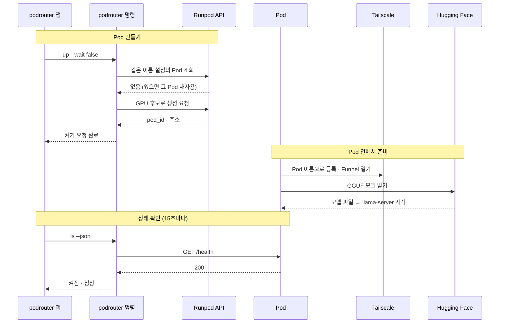
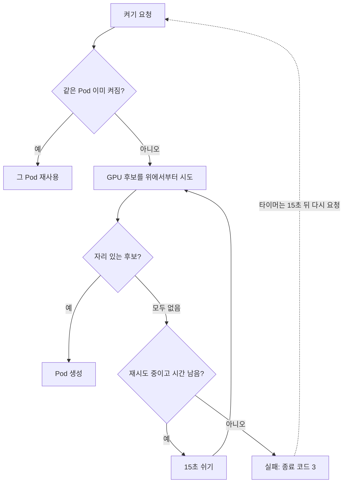

# podrouter

RunPod GPU Pod에 LLM 서버를 켜고 끄는 macOS 앱과 CLI(`podrouter`)입니다.

YAML 파일 하나로 GPU, 모델, 문맥 길이를 정하면 Pod를 만들고, 모델 서버가 응답할 때까지 기다린 뒤 호출 주소를 알려줍니다. 정해진 시간(TTL)이 지나면 Pod가 스스로 지워지므로, 깜빡 잊어도 요금이 계속 나가지 않습니다.

- **맥 앱**: 키 저장, Pod 설정, 켜기/끄기, 요일·시간 예약, 활동 로그를 한 창에서 다룹니다.
- **Claude로 설정 만들기**: 원하는 용도를 말하거나 모델 카드를 붙여넣으면 Claude가 GPU와 공개 GGUF 모델을 골라 설정을 저장합니다.
- **고정 공개 주소**: Runpod 프록시 주소 외에 Tailscale Funnel이나 Cloudflare Tunnel 주소를 쓸 수 있습니다.
- **CLI**: 같은 기능을 터미널에서 `podrouter up / down / ls / status`로 씁니다.

## 설치

macOS 14 이상, Apple Silicon과 Intel Mac 모두 지원합니다.

### Homebrew (권장)

```bash
brew tap hrunj1230/tap
brew trust hrunj1230/tap      # 개인 tap은 한 번 신뢰 등록이 필요합니다
brew install --cask podrouter
```

- Python 3.12가 함께 설치됩니다. 앱을 처음 열면 podrouter 실행 환경을 한 번 준비합니다(1~2분, 인터넷 필요).
- "확인되지 않은 개발자" 경고 없이 열립니다.
- 업데이트: `brew upgrade --cask podrouter`
- 삭제: `brew uninstall --cask podrouter` (키와 Pod 설정이 있는 `~/podrouter`는 지우지 않습니다)

### 직접 받기

1. [최신 릴리스](https://github.com/hrunj1230/podrouter/releases/latest)에서 `podrouter.zip`을 받습니다.
2. 압축을 풀고 `podrouter.app`을 `/Applications`로 옮깁니다.
3. 첫 실행 때 경고가 뜨면 한 번만 해제합니다. Finder에서 Control+클릭 → **열기**, 또는:
   ```bash
   xattr -dr com.apple.quarantine /Applications/podrouter.app
   ```
4. Python 3.10 이상이 필요합니다. 없으면 `brew install python@3.12`.

### 개발용 (git clone)

```bash
git clone https://github.com/hrunj1230/podrouter.git
cd podrouter
./install.sh        # .venv 준비 + ~/Applications/podrouter.app 설치
```

Xcode 명령줄 도구(`xcode-select --install`)와 Python 3.10 이상(또는 uv)이 필요합니다. 이렇게 설치한 앱은 클론 폴더의 `.venv`, `.env`, `pods/`를 씁니다.

## 사용법 (맥 앱)

왼쪽 메뉴 순서대로 진행합니다.

| 화면 | 하는 일 |
| --- | --- |
| 1. 설정 안내 | Claude(`/podrouter-setup`) 또는 Codex(`$podrouter-setup`) 터미널을 열어 키 발급 경로를 안내받습니다. |
| 2. 키 관리 | Runpod API 키(필수)와 선택 키를 저장하고, 공개 주소 방식을 고릅니다. |
| 3. Pod 설정 | 이름, Hugging Face GGUF 모델, GPU, 클라우드, 문맥 길이, 자동 삭제 수명(TTL)을 정해 YAML로 저장합니다. "Claude와 대화로 만들기"로 대화하며 만들 수도 있습니다. 저장한 설정은 이 화면에서 불러오고 지웁니다. |
| 4. 전원 제어 | 저장한 설정으로 Pod를 켜고 끕니다. GPU 자리가 없으면 자리가 날 때까지 15초마다 다시 시도합니다. 15초마다 상태를 확인하고, 준비되면 호출 주소를 보여줍니다. |
| 5. 타이머 | 요일(ON/OFF)과 켜는/끄는 시각을 정하면 launchd가 15초마다 확인해 자동으로 켜고 끕니다. 자리가 없으면 시간대 안에서 계속 다시 시도하고 macOS 알림으로 알려줍니다. 앱을 꺼도 동작하지만, Mac이 켜져 있고 깨어 있을 때만 동작합니다. |
| 6. 로그 | 앱과 타이머가 한 일을 시간순으로 봅니다. 키는 가려집니다. |

### 상단바

맥 상단바의 번개 아이콘으로 창을 열지 않고 Pod 상태를 보고 켜고 끕니다.

- 아이콘: 켜짐 `bolt.fill`, 켜는 중 `bolt.badge.clock`, 모두 꺼짐 `bolt.slash`
- 아이콘을 누르면 Pod 목록(상태, 시간당 가격), 켜기·끄기, 주소 복사, **창 열기**, **종료**가 나옵니다.
- 창을 닫아도 앱은 상단바에 남고 Dock 아이콘만 사라집니다. 완전히 끄려면 상단바의 **종료** 또는 ⌘Q를 누릅니다.
- **로그인할 때 자동 실행**을 켜면 맥에 로그인할 때 창 없이 상단바로만 시작합니다. 시스템 설정 > 일반 > 로그인 항목에도 나옵니다.

호출 주소는 OpenAI 호환 API입니다. 경로 `/v1`을 붙여 씁니다.

```bash
curl https://<호출 주소>/v1/chat/completions \
  -H 'Content-Type: application/json' \
  -d '{"messages":[{"role":"user","content":"안녕"}]}'
```

### Pod가 켜지는 순서



### GPU 자리가 없을 때



- **전원 제어의 켜기 버튼**: 모든 GPU 후보에 자리가 없으면 15초(`timeouts.allocation_retry_sec`) 쉬고 다시 시도합니다. YAML의 `timeouts.allocation_sec` 동안 반복하고, 그때까지 자리가 없으면 실패로 끝납니다. 오래 기다리게 하려면 이 값을 늘립니다(예: `3600`이면 1시간).
- **타이머**: 15초마다 실행될 때 시간대 안인데 Pod가 없으면 켜기를 다시 시도합니다. 처음 자리가 없을 때, 켜졌을 때(몇 번째 시도인지 포함), 자리를 못 찾고 시간대가 끝났을 때 macOS 알림을 한 번씩 보냅니다. 로그에는 첫 실패만 남깁니다.
- 타이머 간격은 **타이머 설치**를 누를 때 적용됩니다. 이전 버전에서 설치했다면 한 번 다시 누릅니다.

Pod는 Runpod 클라우드에서 돌기 때문에 앱을 꺼도 계속 실행되고 요금이 나갑니다. 타이머의 끄는 시각, TTL, 전원 제어의 끄기 중 하나로 꺼집니다. 타이머 예약 스케줄로 켜질 때는 설정된 종료 시각(+15분)에 맞춰 계산된 수명이 YAML의 TTL을 override합니다.

## 공개 주소 방식

키 관리 화면의 "공개 주소 방식"에서 고르며, `.env`의 `PODROUTER_TUNNEL`에 저장됩니다.

| 방식 | 주소 | 필요한 것 |
| --- | --- | --- |
| Runpod 주소만 (`none`) | `https://<pod-id>-<port>.proxy.runpod.net` (Pod를 새로 만들면 바뀜) | 없음 |
| Tailscale Funnel (`tailscale`) | `https://<pod이름>.<tailnet>.ts.net` (고정) | `TS_AUTHKEY` (Reusable, Ephemeral, 태그 없음) |
| Cloudflare Quick Tunnel (`cloudflare`, 토큰 없음) | `https://<임의>.trycloudflare.com` (켤 때마다 바뀜) | 없음 |
| Cloudflare Named Tunnel (`cloudflare`, 토큰 있음) | 대시보드에서 정한 주소 (고정, 예: `llm.example.com`) | `CF_TUNNEL_TOKEN`, Cloudflare DNS에 연결된 도메인 |

Tailscale과 Cloudflare 터널은 Pod 안에서 모델 서버 옆에 함께 실행됩니다. Mac에는 아무것도 설치하지 않습니다. 방식을 바꾸면 이미 켜진 Pod를 재사용하지 않고 새로 만듭니다.

## 데이터 위치

| 위치 | 내용 |
| --- | --- |
| `~/podrouter/.env` | 키와 설정값 (권한 0600). 앱의 키 관리 화면에서 저장합니다. |
| `~/podrouter/pods/` | 저장한 Pod 설정 YAML |
| `~/Library/Application Support/podrouter/` | Python 환경(`venv/`), 타이머 일정(`schedule.json`), 로그(`logs/`) |
| `~/Library/LaunchAgents/io.github.hrunj1230.podrouter.plist` | 타이머를 설치했을 때만 생깁니다 |

개발용으로 설치했다면 `.env`와 `pods/`는 클론 폴더에 있습니다. 둘 다 git에 올라가지 않습니다.

### `.env` 값

| 이름 | 필수 | 설명 |
| --- | --- | --- |
| `RUNPOD_API_KEY` | 예 | Pod 조회, 생성, 종료 |
| `HF_TOKEN` | 아니오 | 승인이 필요한(게이트된) Hugging Face 모델을 받을 때 |
| `MODEL_API_KEY` | 아니오(권장) | 모델 API 비밀번호. 있으면 요청에 `Authorization: Bearer <키>`가 필요하다. 앱의 키 관리 화면에서 자동 생성·복사하거나 직접 입력한다. 바꾸면 Pod를 다시 켜야 적용된다. |
| `PODROUTER_TUNNEL` | 아니오 | `none`, `tailscale`, `cloudflare`. 비어 있으면 `TS_AUTHKEY`가 있을 때 Tailscale |
| `TS_AUTHKEY` | Tailscale 방식일 때 | Tailscale Auth key |
| `CF_TUNNEL_TOKEN` | 아니오 | 있으면 Cloudflare Named Tunnel, 없으면 Quick Tunnel |
| `CF_TUNNEL_HOSTNAME` | 아니오 | Named Tunnel 주소. 화면 표시용 |

## CLI (`podrouter`)

```bash
pip install .            # 또는 개발용 설치의 .venv/bin/podrouter
export RUNPOD_API_KEY=...

podrouter up examples/a40.yaml --api-key '${RUNPOD_API_KEY}'      # 켜고 준비될 때까지 대기
podrouter up examples/a40.yaml --wait false --api-key '${RUNPOD_API_KEY}'
podrouter up examples/a40.yaml --retry false --api-key '${RUNPOD_API_KEY}'  # 자리 없으면 재시도 없이 바로 끝냄
podrouter status qwen38-27b --api-key '${RUNPOD_API_KEY}'          # 상태, 시간당 가격, 남은 TTL
podrouter ls --api-key '${RUNPOD_API_KEY}'                         # 이 도구가 만든 Pod만
podrouter ls --json --api-key '${RUNPOD_API_KEY}'                  # 앱이 쓰는 형식 (헬스 체크 포함)
podrouter down qwen38-27b --api-key '${RUNPOD_API_KEY}'
podrouter down --all --api-key '${RUNPOD_API_KEY}'
podrouter schedule show | install | tick                           # 타이머 (앱이 호출)
```

`up`은 GPU 자리를 못 찾으면 종료 코드 3으로 끝납니다. 다른 실패는 1, 설정 오류는 2입니다.

`--api-key`에는 키 값 대신 `${RUNPOD_API_KEY}` 같은 환경변수 참조를 넘깁니다. 키 값이 셸 기록과 프로세스 목록에 남지 않게 하기 위해서입니다.

## Pod 설정 YAML

앱의 Pod 설정 화면이나 Claude가 만드는 파일과 같은 형식입니다. 비밀값은 `${ENV}`로만 적습니다.

```yaml
name: qwen38-27b                       # 영문, 숫자, 하이픈. Pod를 찾는 기준
image: ghcr.io/ggml-org/llama.cpp:server-cuda13
args: -hf bartowski/orcarouter_Qwen3.8-27B-Uncensored-GGUF:Q4_K_M --host 0.0.0.0 --port 8080 -c 196608 -ngl 99 --jinja

gpu:
  candidates:                          # 위에서부터 시도. 재고가 없으면 다음 후보, 모두 없으면 처음부터 다시
    - NVIDIA A40
  count: 1
  cloud: SECURE                        # SECURE, COMMUNITY, ALL
  # max_price_per_hour: 1.0            # 생성을 막지 않고, 가격은 결과에 출력

storage:
  container_disk_gb: 60
  network_volume_id: null

env: {}                                # 예: HF_TOKEN: ${HF_TOKEN}

port: 8080
readiness:
  path: /health                        # 200이 되면 준비 완료
  interval_sec: 10
  timeout_sec: 1800

lifecycle:
  ttl: 3h                              # 필수. 지나면 Pod가 스스로 지워짐 (기본 3h, 30m, 1h30m 형식)

timeouts:
  allocation_sec: 180                  # GPU 자리를 찾는 최대 시간 (기본 300)
  allocation_retry_sec: 15             # 자리가 없을 때 다시 시도하는 간격 (기본 15)
  boot_sec: 1200
  boot_interval_sec: 5
```

예제는 `examples/a40.yaml`(llama.cpp, A40)과 `examples/serve.yaml`(vLLM)에 있습니다.

## 안전장치

- **TTL 자동 삭제**: 컨테이너 시작 명령에 `runpodctl remove pod` 타이머를 넣습니다. Mac이 꺼져 있어도 Pod는 TTL이 지나면 지워집니다(기본 3h, 30m/1h30m 등 지원. 타이머 예약 실행 시에는 예약 종료 시각(+15분)에 맞춰 계산된 수명이 YAML TTL을 override).
- **실패 시 정리**: 부팅이나 헬스 체크가 시간 안에 끝나지 않거나, 오류가 나거나, Ctrl+C를 누르면 마지막 로그 50줄을 보여주고 그 Pod를 종료합니다.
- **재사용**: 이름과 설정 해시가 같은 Pod가 이미 있으면 새로 만들지 않고 그 Pod를 씁니다. 설정을 바꾸면 새 Pod를 만듭니다.
- **관리 대상만**: `ls`, `down --all`, 앱은 이 도구가 만든 Pod만 다룹니다. `.env`의 `PODROUTER_PROTECTED_PODS`(쉼표 구분, 기본은 비어 있음)에 적은 이름은 한 번 더 막아서, 같은 이름으로 만들거나 끄거나 예약하지 않습니다.
- **키 가림**: 출력, 로그, 앱 화면에서 키 값을 `***`로 바꿉니다. Claude는 프로젝트 설정으로 `.env`를 읽지 못합니다.

## 프로젝트 구조

```
.
├── src/podrouter/               Python 패키지 (CLI, Runpod 호출, 타이머)
│   ├── cli.py                podrouter 명령 파싱
│   ├── config.py             YAML 읽기, ${ENV} 치환, 설정 해시
│   ├── provision.py          Pod 생성 → 부팅 대기 → 헬스 체크 → 실패 시 종료
│   ├── client.py             runpod SDK와 GraphQL 호출
│   ├── tunnel.py, funnel.py  공개 주소 방식 (Cloudflare, Tailscale)
│   ├── local_schedule.py     launchd 타이머 (schedule install / tick)
│   ├── planner.py            GPU·모델 고르기 규칙과 YAML 만들기
│   ├── catalog.py            GPU 가격·재고 조회
│   ├── envfile.py            .env 읽기와 키 가림
│   └── paths.py              데이터 폴더(PODROUTER_HOME) 위치
├── apps/podrouter/         SwiftUI 맥 앱
│   └── Sources/
│       ├── Views/            화면 7개와 상단바 (설정 안내, 키, Pod, 전원, 타이머, 로그, 연결)
│       ├── Models/           앱 상태
│       └── Services/         Runtime(설치형/개발용 판별), PythonSetup(첫 실행 준비),
│                             SecretStore(.env), ProcessRunner, Redactor, ActivityLog
├── .claude/skills/           Claude 스킬: /podrouter-setup, /podrouter-pod
├── .grok/skills/podrouter-yaml/ YAML 도우미 스크립트 (render_plan.py: catalog, render, inspect, guide)
├── examples/                 예제 YAML
├── docs/                     설정 안내(user-setup.md), ADR, 동작 설명 HTML
├── tests/                    pytest (로컬 Runpod 흉내 서버로 실제 호출 없이 검사)
├── packaging/homebrew/       Homebrew cask 원본
├── scripts/                  build-app.sh (배포 zip), release.sh (릴리스)
└── install.sh                개발용 설치
```

맥 앱은 직접 Runpod를 부르지 않고 `python -m podrouter`을 실행합니다. 설치형 앱에는 podrouter이 wheel로 들어 있고, 처음 실행할 때 `~/Library/Application Support/podrouter/venv`에 설치됩니다.

## 개발

```bash
./install.sh --python-only                  # .venv만 준비
.venv/bin/python -m pip install -e '.[dev]'
.venv/bin/python -m pytest -q               # 실제 Runpod 호출 없음
swift build --package-path apps/podrouter
```

환경변수로 동작을 바꿀 수 있습니다.

| 이름 | 용도 |
| --- | --- |
| `PODROUTER_HOME` | `.env`와 `pods/`가 있는 폴더 (앱이 넘겨줌) |
| `RUNPOD_API_BASE_URL` | runpod SDK가 쓰는 GraphQL 주소 (테스트용 흉내 서버) |
| `PODROUTER_HEALTH_BASE` | 헬스 체크를 보낼 주소 |

## 배포 (관리자)

```bash
./scripts/release.sh --check-only   # 테스트 + build/podrouter.zip
./scripts/release.sh 0.2.0          # 버전 올리기 → 태그 → GitHub Release → Homebrew tap 갱신
```

공개 저장소 `hrunj1230/podrouter`(앱)와 `hrunj1230/homebrew-tap`(cask)이 필요합니다. 앱은 Apple 공증 없이 임시 서명만 하고, cask가 설치할 때 격리 속성을 지웁니다.

## 더 보기

- [docs/user-setup.md](docs/user-setup.md): 키, Tailscale, Cloudflare 설정 상세
- [docs/adr/0001-tailscale-funnel.md](docs/adr/0001-tailscale-funnel.md): 고정 주소 방식을 고른 이유
- `docs/service-logic.html`: 서비스 흐름 그림
